# Визиты, регистрации и реклама: анализ за март — август 2023

Период: **01.03.2023 — 31.08.2023** (184 дня).
Источники: API визитов и регистраций, выгрузка рекламных кампаний `ads.csv`.
Расчёты и графики: [`charts_project.ipynb`](charts_project.ipynb).

---

## 1. Коротко

- **Реклама работает.** В дни кампаний визитов в среднем на **49% больше**, регистраций на **32% больше**, чем в дни без рекламы.
- **Все просадки в визитах и регистрациях — это паузы между кампаниями.** Самые слабые дни (11.05, 20.06, 27.07) приходятся на паузы.
- **Кампании сильно различаются по отдаче.** Одна дополнительная регистрация стоила от **3,7** у.е. (advanced_algorithms_series) до **20** у.е. (ui_ux_design_drive).
- **women_in_tech_symposium привела много трафика, но плохого качества.** Конверсия в приложениях упала с ~83% до ~64%.
- **Способы регистрации не ломались.** Доли email / google / apple / yandex стабильны весь период.
- **Самая большая точка роста — web.** На web приходится 86% визитов, а конверсия там всего ~6% (в приложениях 74–80%).

---

## 2. Данные и как считали

| Показатель | Значение |
|---|---|
| Визитов в выгрузке API | 263 459 |
| Из них визиты ботов (`bot` в User-Agent) — исключены | 7 382 |
| Визитов после исключения ботов, последний визит на `visit_id` | 138 703 |
| Регистраций | 21 836 |
| Конверсия визитов в регистрации за период | **15,7%** |
| Затраты на рекламу за период | 27 534 у.е. |

- Конверсия = регистрации за день / визиты за день × 100, отдельно по каждой платформе.
- Пользователь мог заходить несколько раз до регистрации, поэтому для каждого `visit_id` берём только последний визит.
- «Дни без рекламы» (`none`, 42 дня) — это базовый уровень: **547 визитов и 95 регистраций в день**.

Как читать графики:

- динамика визитов, регистраций и конверсии показана **по неделям**, значение подписано у каждого столбца или точки. Первая (01.03–05.03) и последняя (28.08–31.08) недели неполные и помечены `*`;
- графики с рекламными кампаниями показаны **по дням**: над каждой кампанией и паузой подписано среднее за день, пунктир — то же среднее на графике.

---

## 3. Общая динамика

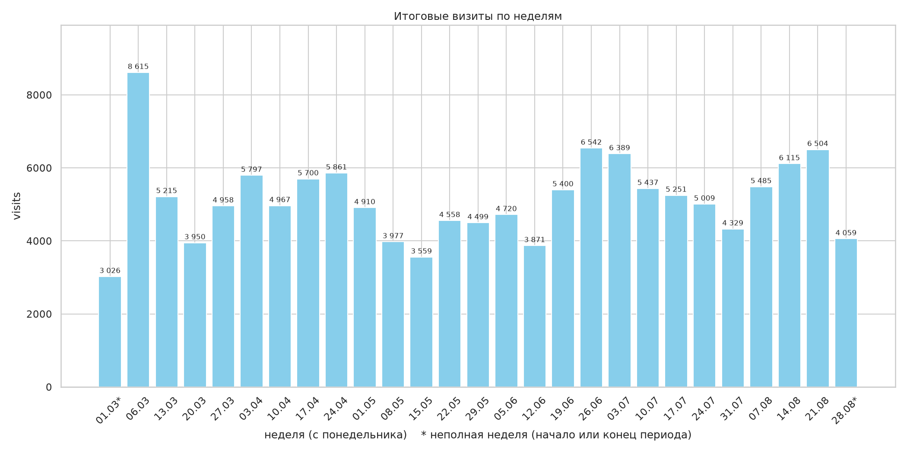

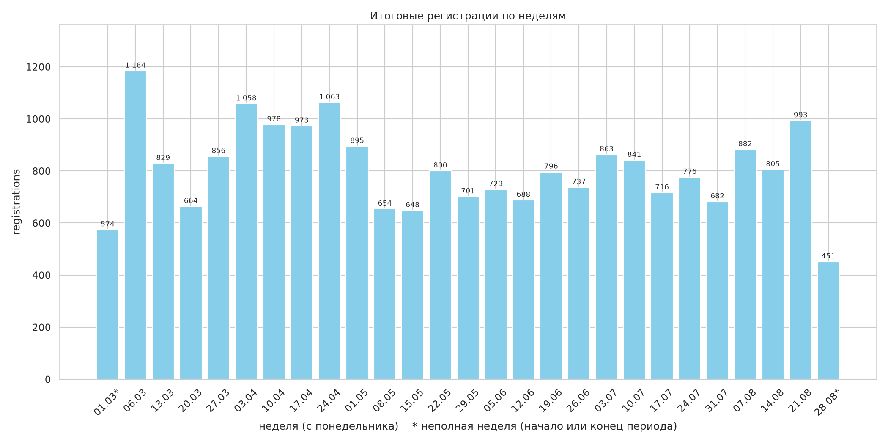

Визиты и регистрации идут «волнами», и волны совпадают с рекламными кампаниями (см. следующий раздел). Явного роста или падения за полгода нет. Выраженной недельной сезонности тоже нет: средние по дням недели отличаются не больше чем на ±10%.

---

## 4. Платформы: трафик на web, регистрации в приложениях

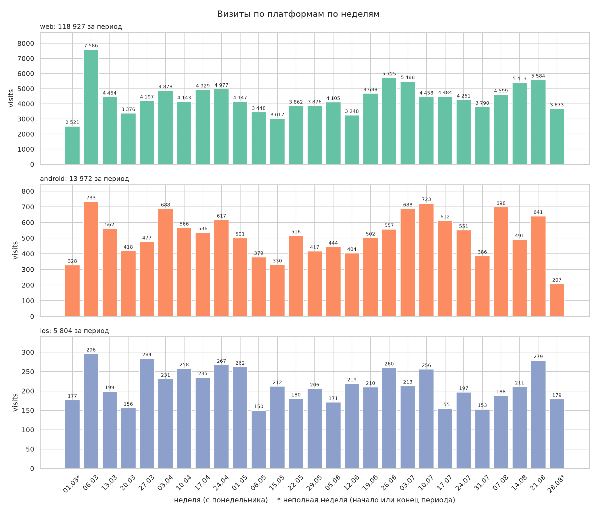

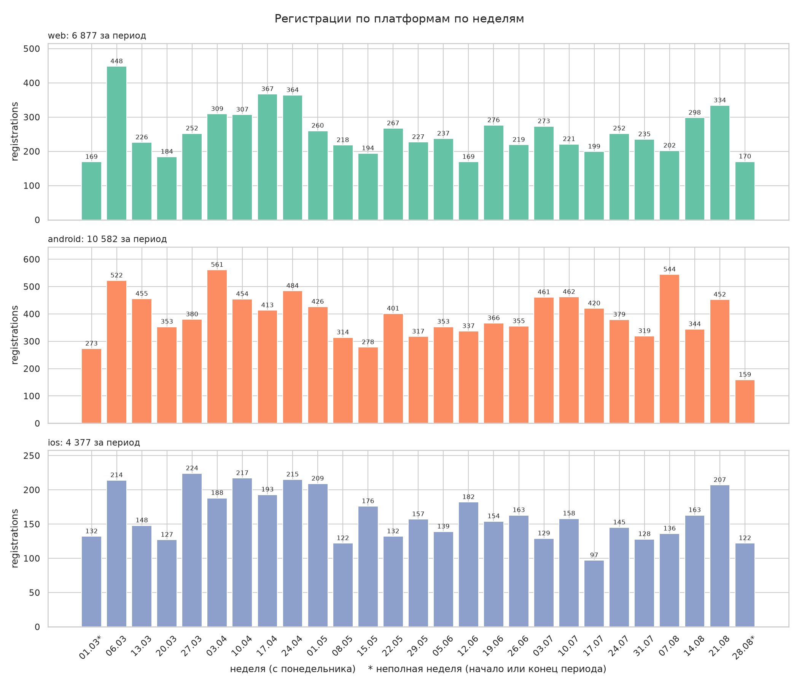

| Платформа | Визиты | Доля визитов | Регистрации | Доля регистраций | Конверсия |
|---|---|---|---|---|---|
| web | 118 927 | 85,7% | 6 877 | 31,5% | **5,8%** |
| android | 13 972 | 10,1% | 10 582 | 48,5% | **75,7%** |
| ios | 5 804 | 4,2% | 4 377 | 20,0% | **75,4%** |

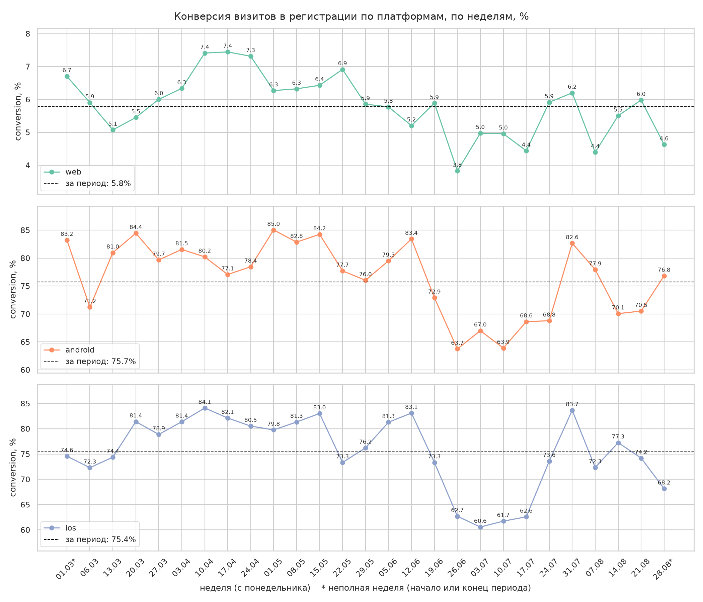

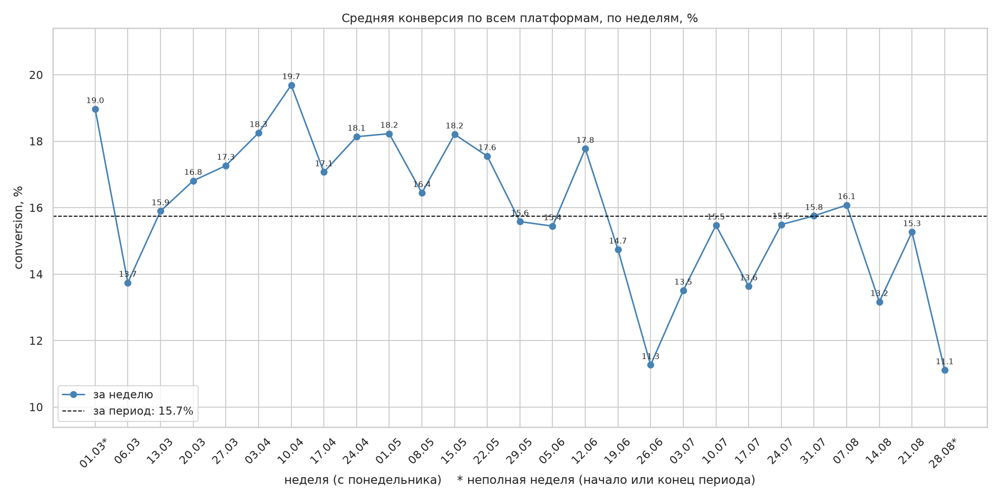

- В приложение приходят уже с намерением зарегистрироваться, а на web много «смотрящего» трафика.
- Общая конверсия (15,7%) почти целиком определяется web, поэтому её надо смотреть **по платформам отдельно**.

---

## 5. Увеличиваются ли заходы и регистрации с запуском рекламы?

**Да.**

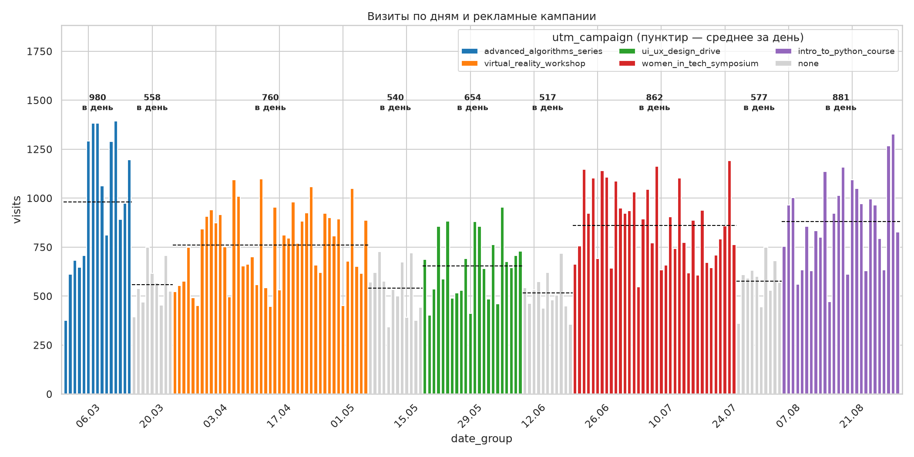

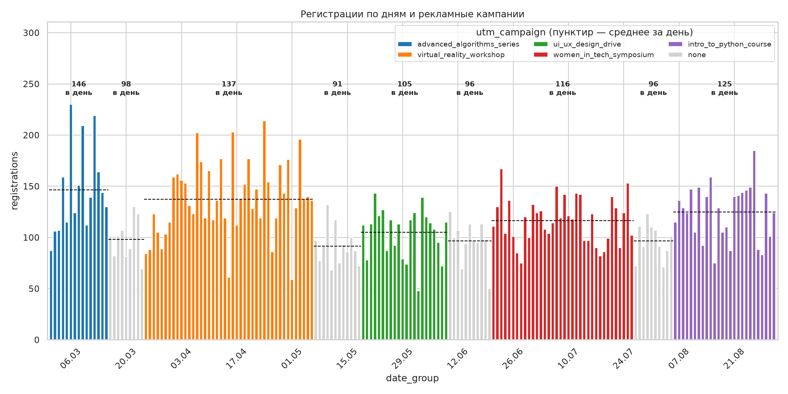

| | Визитов в день | Регистраций в день | Конверсия |
|---|---|---|---|
| Дни с рекламой | 815 | 125,6 | 15,4% |
| Дни без рекламы | 547 | 95,3 | 17,4% |
| **Разница** | **+49%** | **+32%** | −2,0 п.п. |

Визиты растут сильнее, чем регистрации: рекламный трафик в среднем «холоднее» органического, поэтому конверсия в дни рекламы немного ниже. Это нормально. Важно, сколько **дополнительных** регистраций даёт кампания и сколько они стоят (раздел 8).

На всех переходах «пауза → кампания» трафик растёт уже в первые дни, а на переходах «кампания → пауза» сразу падает.

---

## 6. Были ли просадки в заходах?

**Да, четыре, и все совпадают с паузами в рекламе.**

| Пауза | Дней | Визитов в день | Регистраций в день |
|---|---|---|---|
| 16.03 — 24.03 | 9 | 558 | 98 |
| 07.05 — 18.05 | 12 | 540 | 91 |
| 10.06 — 20.06 | 11 | 517 | 97 |
| 27.07 — 05.08 | 10 | 577 | 96 |

- Пять дней с минимумом визитов из шести приходятся на паузы: 11.05 (344), 20.06 (357), 27.07 (362), 17.05 (376), 15.05 (391). Шестой — 01.03 (376), первый день advanced_algorithms_series, когда кампания ещё не разогналась.
- Внутри кампаний заметных провалов нет. Отдельно стоит **ui_ux_design_drive** (19.05 — 09.06): с ней визитов всего на 20% выше, чем без рекламы.

---

## 7. Были ли просадки в регистрациях?

**Да.** Помимо пауз, есть два периода, когда регистраций было меньше, чем позволял трафик:

1. **ui_ux_design_drive (19.05 — 09.06)** — 105 регистраций в день, почти как без рекламы (95). Минимум регистраций за весь период — **02.06, 48 регистраций**, в разгар этой кампании.
2. **women_in_tech_symposium (21.06 — 26.07)** — визитов в день много (862, второй результат), а регистраций мало (116). Конверсия **13,5%**, худшая из всех периодов.

Конверсия по платформам в разные периоды:

| Период | android | ios | web |
|---|---|---|---|
| Без рекламы | 83,9% | 82,6% | 5,9% |
| advanced_algorithms_series | 75,2% | 71,9% | 6,0% |
| virtual_reality_workshop | 80,3% | 81,1% | 6,7% |
| ui_ux_design_drive | 78,1% | 77,3% | 6,2% |
| **women_in_tech_symposium** | **65,5%** | **63,2%** | **4,9%** |
| intro_to_python_course | 73,9% | 73,6% | 5,2% |

Во время women_in_tech_symposium конверсия упала **одновременно на всех трёх платформах**. Сразу после окончания кампании (27.07) она вернулась к ~83% в приложениях.

---

## 8. Связаны ли просадки с бюджетом или сменой креатива?

**С бюджетом нет, со сменой кампании (креатива) да.**

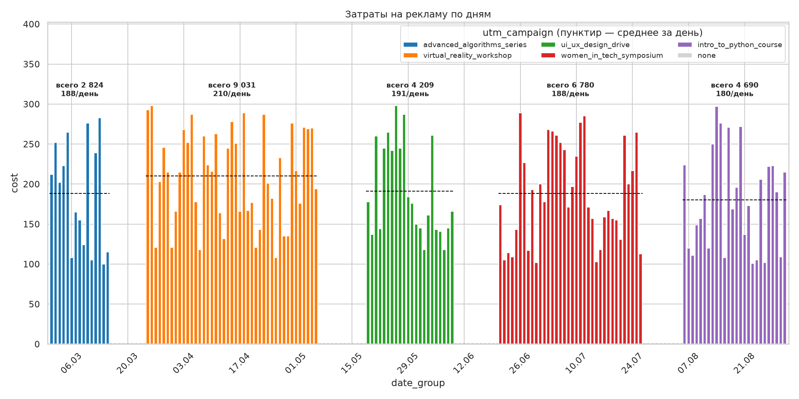

- Затраты в день у всех кампаний примерно одинаковые: 180–210 у.е.
- Внутри кампаний дневной бюджет почти не связан с результатом. Корреляция затрат с визитами −0,20, с регистрациями −0,03.
- Результат определяет **сама кампания**: источник, аудитория, креатив.

| Кампания | Источник | Период | Затраты | Доп. визитов в день | Доп. регистраций в день | **Цена доп. регистрации** |
|---|---|---|---|---|---|---|
| advanced_algorithms_series | google | 01.03 — 15.03 | 2 824 | +434 | +51,1 | **3,7** |
| virtual_reality_workshop | yandex | 25.03 — 06.05 | 9 031 | +214 | +41,8 | **5,0** |
| intro_to_python_course | vk | 06.08 — 31.08* | 4 690 | +335 | +29,5 | **6,1** |
| women_in_tech_symposium | google | 21.06 — 26.07 | 6 780 | +315 | +20,9 | **9,0** |
| ui_ux_design_drive | google | 19.05 — 09.06 | 4 209 | +108 | +9,6 | **20,0** |

\* Кампания шла до 17.09, в анализ попали дни до 31.08.

«Дополнительные» визиты и регистрации считаются как прирост к уровню дней без рекламы. Цена доп. регистрации = затраты в день / доп. регистраций в день.

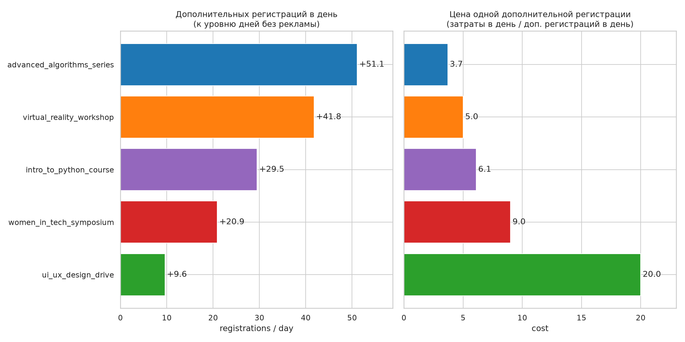

- Самые эффективные кампании: **advanced_algorithms_series** и **virtual_reality_workshop**.
- **ui_ux_design_drive** почти ничего не добавила: одна дополнительная регистрация стоила в 4–5 раз дороже, чем у лучших кампаний.
- **women_in_tech_symposium** привела много визитов, но эта аудитория плохо регистрируется.

---

## 9. Регистрации просели из-за трафика или сломался способ регистрации?

**Из-за трафика. Способы регистрации работали весь период.**

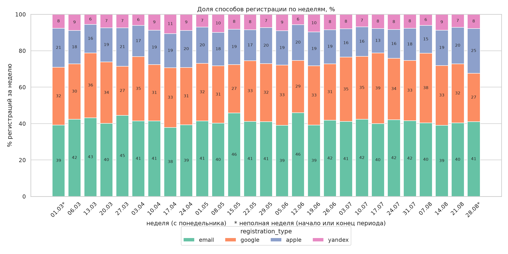

По неделям доли способов держатся в узких пределах: email 38–46%, google 26–39%, apple 13–25%, yandex 5–11%. Ни один способ не пропадал.

Доли способов регистрации внутри платформы не меняются ни в одной кампании:

| Платформа | Способы | Доли во все периоды |
|---|---|---|
| android | email / google | 48–51% / 49–52% |
| ios | email / apple | 45–50% / 50–55% |
| web | email / google / apple / yandex | по 22–27% |

- Если бы сломался, например, вход через Google, его доля упала бы до нуля, а у остальных способов выросла бы. Такого нет.
- Нулевых дней по способу регистрации всего два, оба на web: yandex 01.03 и google 20.06. При среднем ~9 регистраций в день по каждому способу это случайная флуктуация, на следующий день оба способа работают как обычно.
- Просадка во время women_in_tech_symposium одинаково затронула все платформы и все способы регистрации. Значит, причина в аудитории кампании, а не в технике.

---

## 10. Рекомендации

1. **Не делать пауз между кампаниями.** В каждой паузе регистраций в день примерно на 25% меньше, чем в среднем по дням с рекламой (95 против 126). Пауз было 42 дня, это около 1 300 потерянных регистраций.
2. **Масштабировать удачные форматы.** Креативы и аудитории advanced_algorithms_series (google) и virtual_reality_workshop (yandex) дают дополнительную регистрацию за 3,7–5 у.е.
3. **Не повторять ui_ux_design_drive в текущем виде** (20 у.е. за доп. регистрацию). Если тема важна, сменить креатив или источник.
4. **Разобрать women_in_tech_symposium.** Трафик кампании плохо конвертируется во всех каналах. Нужно проверить таргетинг и соответствие посадочной страницы обещанию в рекламе.
5. **Заняться регистрацией на web.** Там 86% визитов и конверсия ~6%. Рост конверсии web даже на 1 п.п. даёт ~1 200 регистраций за полгода (+17% к регистрациям с web), и для этого не нужен рекламный бюджет. Варианты: упростить форму, вынести вход через Google и Yandex на первый экран, предлагать установить приложение.
6. **Улучшить данные для атрибуции.**
   - Передавать `utm_*` в визиты и связывать `visit_id` с `user_id`. Сейчас общего ключа нет, и конверсию можно считать только по дням.
   - Настроить ежедневный алерт на ноль регистраций по любому способу. Поломки сейчас нет, но так её заметят в тот же день.

---

## 11. Ограничения анализа

- **Атрибуция по дням.** Визиты и регистрации нельзя связать напрямую, поэтому эффект кампании оценивается как разница с днями без рекламы, а не по конкретным пользователям.
- **Отложенный эффект.** Часть регистраций в первые дни пауз может быть отложенным эффектом предыдущей кампании. Тогда реальная отдача рекламы немного выше, чем в таблицах.
- **Дубли визитов только на web.** Повторные визиты по `visit_id` есть только на web. Визиты в приложениях все уникальные, поэтому их число может быть завышено, если приложение не сохраняет `visit_id` между сессиями.
- **Валюта неизвестна.** В выгрузке рекламы она не указана, поэтому затраты приведены в условных единицах (у.е.).
